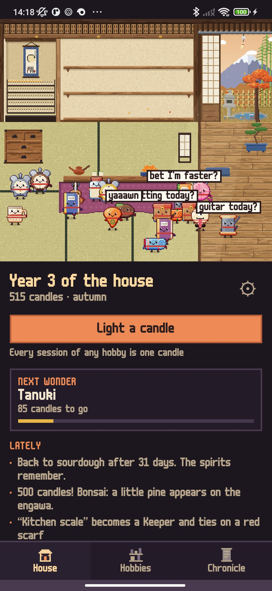
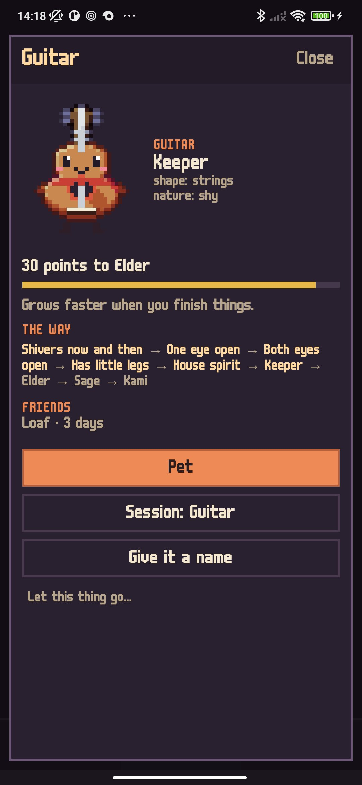
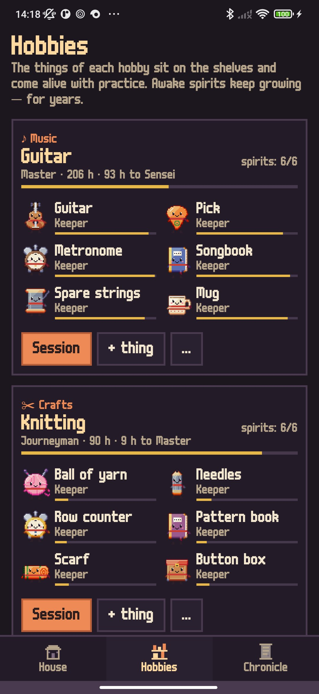
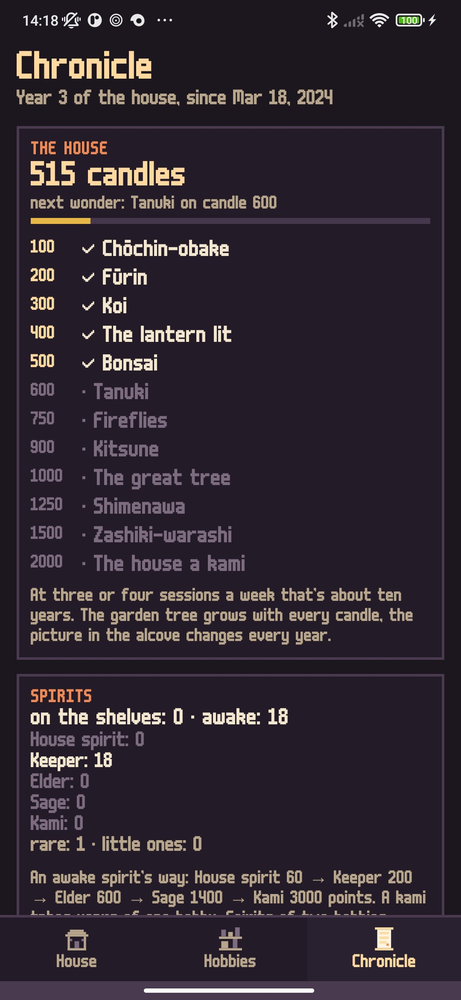
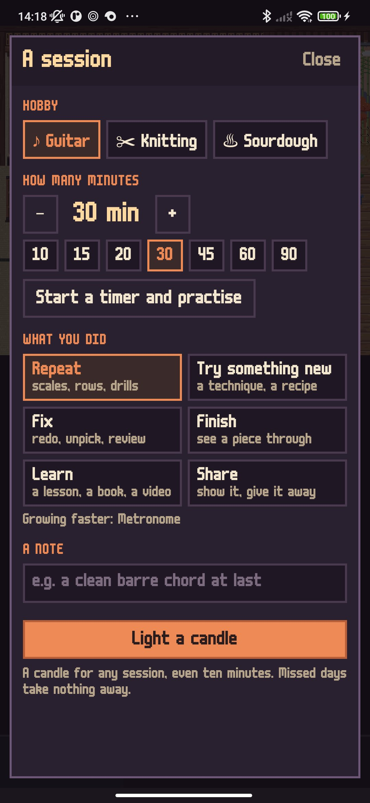

<div align="center">


# Tsukumo

### The things of your hobbies come alive with practice.

*In Japan they say that things used long and well grow a soul — tsukumogami. Here it happens to the things of your hobbies: a guitar, a ball of yarn, a brush, a sourdough starter. Every session lights a candle in a small pixel-art Japanese house; the things on the shelves shiver, open an eye, grow little legs and step down as house spirits — and keep growing for years. Free, no ads, no account.*

[](https://github.com/bigdevwhale/tsukumo/actions/workflows/android.yml)
[](https://github.com/bigdevwhale/tsukumo/releases/latest)


[](LICENSE)

**English** · [Русский](README.ru.md) · [Changelog](CHANGELOG.md)

    

</div>

---

## How it works

1. **Any hobby.** 39 ready-made hobbies in nine families (music, drawing and photo, crafts, kitchen and tea, words, mind, movement, garden, making), each with the things people really use for it — or your own hobby with your own things. Type "the mug with a cat" and it gets a silhouette, a colour and a nature of its own.
2. **A session is a candle.** After practising, note the minutes and what you did: repeat, try something new, fix, finish, learn, share. Every thing loves one verb and grows faster from it. A built-in timer can count the session for you.
3. **Waking up.** A thing shivers, opens one eye, then both, grows little legs and steps off the shelf as a house spirit. The first ones wake after a few weeks.
4. **Growing for years.** Awake spirits become Keepers (a red scarf), Elders (white brows and patina), Sages (a straw hat) and, after many years of one hobby, Kami (a halo). Hobbies earn titles by hours, from Beginner to Living treasure at 3000 hours.
5. **The house grows too.** The hundred candles in the alcove are the old Hyakumonogatari: every hundred brings a party and sometimes a wonder — a paper-lantern spirit, a wind chime, koi in the pond, the stone lantern lit, a bonsai, a tanuki, fireflies, a white fox, the garden tree fully grown and made sacred, a child spirit, and at last a house that is a kami itself. At three or four sessions a week that's about ten years.
6. **Friends and little ones.** Spirits of two hobbies practised on the same day become friends; after a while they have a little one, one's shape in the other's colour.
7. **No guilt.** Missed days take nothing away. After a long break the spirits are just asleep under the kotatsu. A hobby can go into the storeroom chest and come back a year later — the spirits remember.
8. **The chronicle.** Year by year: who woke, who rose in rank, which wonders came, your notes.

The house follows the real seasons and the hour: blossom in spring, fireflies on summer nights, falling maple leaves, snow on the eaves; the paper lamp and the candles light the room at night.

## Privacy

No account, no ads, no analytics, no internet permission. Everything stays on the phone.

## Building

```bash
./gradlew testDebugUnitTest assembleDebug                  # app.tsukumo.dev, next to a real install
./gradlew assembleDebug -Pdemo                             # app.tsukumo.demo, a few years already lived
./gradlew testDebugUnitTest -Prender --tests '*RenderArt*' # scene and sprite sheets in app/build/art
python tools/icon.py                                       # the launcher icon and the logo, from the app's own sprite
```

Kotlin, Jetpack Compose, Room, DataStore. Every picture is pixel art drawn in code: the house (360×320 art pixels, an exact 3× on 1080-wide phones), the garden in four seasons, and the spirits — about twenty silhouettes painted into material grids and shaded automatically, with hue-shifted ramps and selective outlines. `EngineTest` lives ten years in the house and checks the pace stays slow and steady.

## License

[MIT](LICENSE). Font: m6x11 by Daniel Linssen, Cyrillic by Natto Games (free with attribution).
