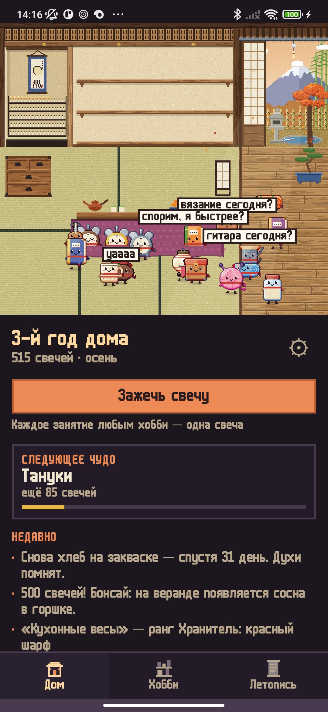
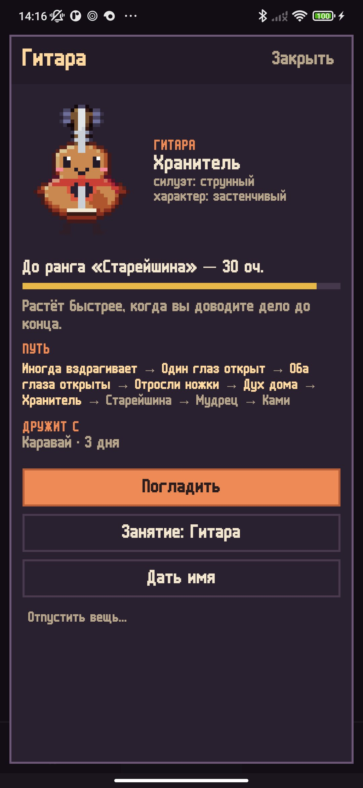
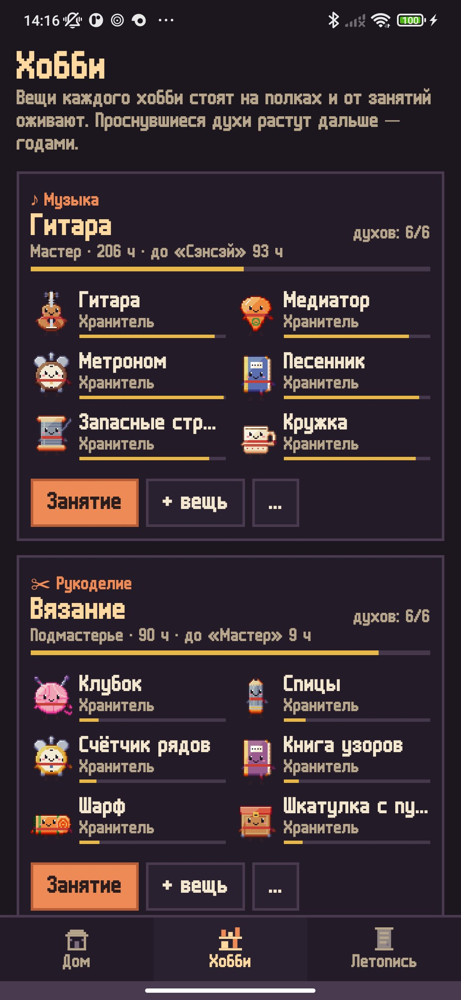
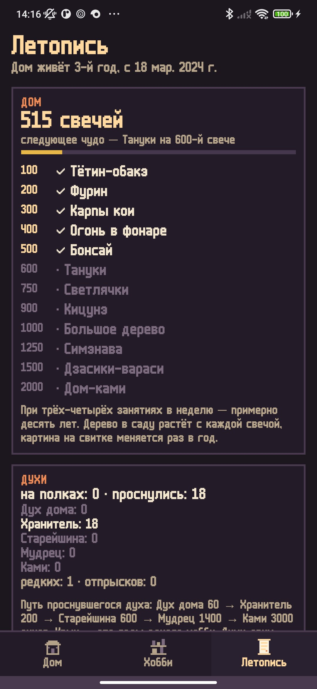
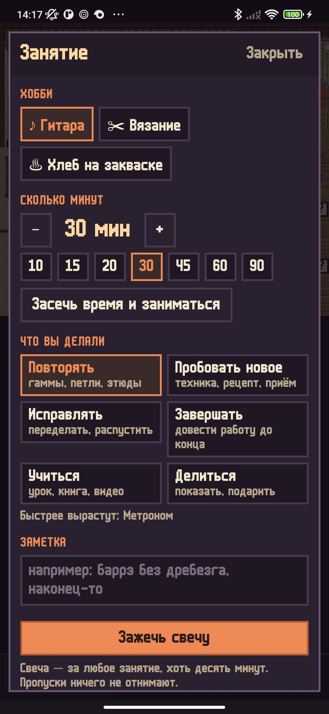

<div align="center">


# Цукумо

### Вещи ваших хобби оживают от практики.

*В Японии говорят, что вещи, которыми долго и бережно пользуются, обретают душу, — это цукумогами. Здесь так происходит с вещами ваших хобби: гитарой, клубком, кистью, закваской. Каждое занятие зажигает свечу в маленьком пиксельном японском доме; вещи на полках вздрагивают, открывают глаз, отращивают ножки и сходят на пол духами дома — и растут дальше, годами. Бесплатно, без рекламы и аккаунтов.*

[](https://github.com/bigdevwhale/tsukumo/actions/workflows/android.yml)
[](https://github.com/bigdevwhale/tsukumo/releases/latest)


[](LICENSE)

[English](README.md) · **Русский** · [Изменения](CHANGELOG.md)

    

</div>

---

## Как это устроено

1. **Любое хобби.** 39 заготовок в девяти семействах (музыка, рисунок и фото, рукоделие, кухня и чай, слова, ум, движение, сад, мастерская) — с вещами, которыми для них правда пользуются. Или своё хобби со своими вещами: впишите «кружка с котом», и у неё появятся силуэт, цвет и характер.
2. **Занятие — свеча.** После занятия отметьте минуты и что вы делали: повторяли, пробовали новое, исправляли, завершали, учились, делились. У каждой вещи свой любимый глагол — от него она растёт быстрее. Время можно засечь встроенным таймером.
3. **Пробуждение.** Вещь вздрагивает, открывает один глаз, потом оба, отращивает ножки и сходит с полки духом дома. Первые просыпаются через несколько недель.
4. **Годы роста.** Проснувшиеся духи становятся Хранителями (красный шарф), Старейшинами (седые брови и патина), Мудрецами (соломенная шляпа) и после многих лет одного хобби — Ками (нимб). Хобби получают звания по часам: от Новичка до Живого сокровища на 3000 часов.
5. **Дом тоже растёт.** Сто свечей в нише — это старинное Хякумоногатари: каждая сотня — праздник, а иногда и чудо: бумажный фонарь-дух, фурин, карпы в пруду, огонь в каменном фонаре, бонсай, тануки, светлячки, белая лиса, дерево в полную силу и со священной верёвкой, дух-ребёнок, и наконец дом, который сам стал ками. При трёх-четырёх занятиях в неделю — примерно десять лет.
6. **Дружба и отпрыски.** Духи двух хобби, которыми вы занимались в один день, дружат; со временем у них появляется малыш — силуэт одного, цвет другого.
7. **Без чувства вины.** Пропуски ничего не отнимают. После долгого перерыва духи просто спят под котацу. Хобби можно убрать в сундук-кладовую и достать через год — духи помнят.
8. **Летопись.** Год за годом: кто проснулся, кто вырос в ранге, какие чудеса пришли, ваши заметки.

Дом живёт по настоящим временам года и часам: сакура весной, светлячки летними ночами, кленовые листья осенью, снег на стрехе зимой; ночью комнату освещают бумажный фонарь и свечи.

## Приватность

Без аккаунта, рекламы, аналитики и даже без разрешения на интернет. Всё хранится только на телефоне.

## Сборка

```bash
./gradlew testDebugUnitTest assembleDebug                  # app.tsukumo.dev рядом с настоящей установкой
./gradlew assembleDebug -Pdemo                             # app.tsukumo.demo — несколько прожитых лет
./gradlew testDebugUnitTest -Prender --tests '*RenderArt*' # листы сцен и духов в app/build/art
python tools/icon.py                                       # иконка и логотип из спрайта самого приложения
```

Kotlin, Jetpack Compose, Room, DataStore. Вся графика — пиксель-арт, нарисованный кодом: дом (360×320 пикселей, ровно 3× на экранах шириной 1080), сад в четырёх временах года и духи — около двадцати силуэтов, которые рисуются сеткой материалов и затеняются автоматически, со сдвигом оттенка и цветным контуром. `EngineTest` проживает в доме десять лет и проверяет, что темп остаётся медленным и ровным.

## Лицензия

[MIT](LICENSE). Шрифт: m6x11 — Daniel Linssen, кириллица — Natto Games (бесплатно с указанием авторства).
